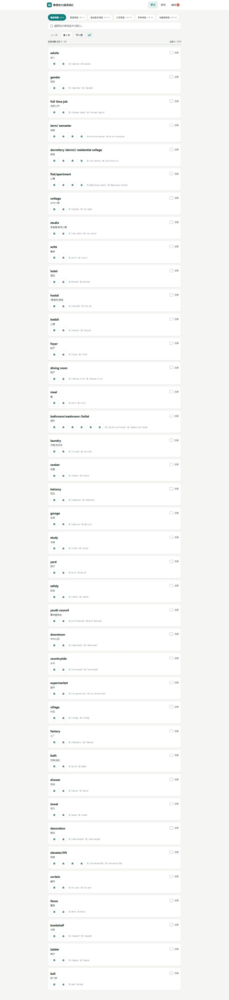
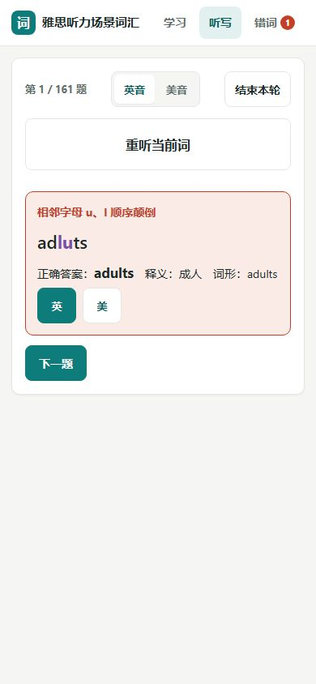
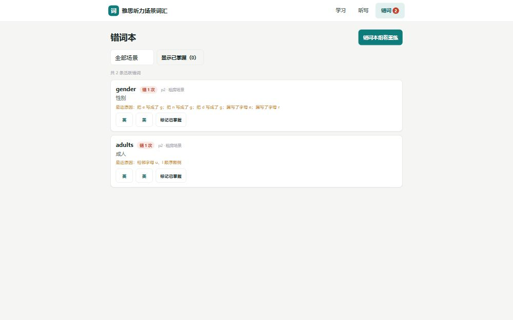
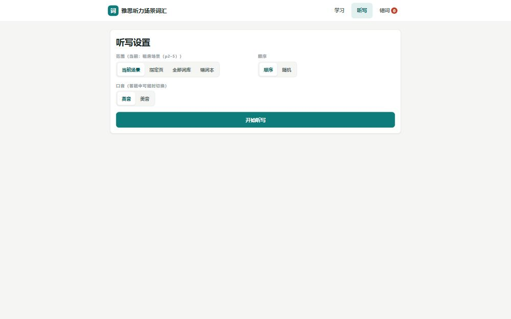
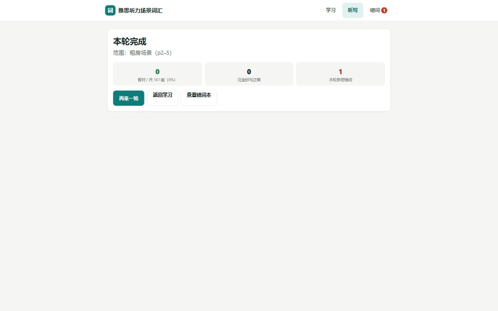

# 雅思听力词汇 · 场景词 / 机经词

把新东方《听力场景词汇（new）》教研资料做成的一个**纯静态、双击即运行**的网页词汇本：**1078 个词条 / 1178 个可发音词形 / 6 大听力场景**，按原 PDF 第 2–30 页分页排列，每个词都有独立的英音、美音发音按钮，并内置本地"AI 听写批改"——逐字符高亮你的拼写错误、用中文告诉你错在哪。全部数据在本地，**无需构建、无需服务器、无需任何 API key**。

## 在线试用

**GitHub Pages**：<https://gherz2786886-png.github.io/ielts-listening-vocab/>

## 功能清单

- **学习模式**
  - 6 大场景切换（租房 / 旅游 / 运动音乐 / 工作 / 学术 / 动植物），场景内按原 PDF 页码分页（上一页 / 下一页 / 页码跳转）。
  - 词卡完整呈现：单词（含斜杠并列词形）、中文释义、英式音标、美式音标。
  - 每个词（含每个并列词形）独立的 **英音 / 美音两个发音按钮**，互不阻塞、可随时打断重听。
  - 跨页搜索：英文、中文均可命中。
  - "已错"错因标记（意思 / 拼写 / 听错，可多选）+ 进度条，localStorage 持久化，关掉浏览器再来接着学。
- **听写模式**
  - 范围可选：当前页 / 当前场景 / 全部词库 / 错词本；顺序 / 随机两种出词方式。
  - 播放目标词发音后输入拼写，提交即批改：
    - **逐字符高亮**：错写（红）/ 漏写（橙）/ 多写（蓝）/ 相邻字母颠倒（紫）/ 大小写·空格差异（灰）；
    - **中文错误原因**，如"漏写了字母 a""相邻字母 e/i 顺序颠倒""双写错误：p 应双写""英式/美式拼写差异（-our/-or）"等；
    - 仅大小写 / 空格 / 连字符差异视为正确并给柔和格式提示。
  - 本轮正确率统计；错题自动收入错词本。
- **错词本**
  - 每条错词带错因标签（意思 / 拼写 / 听错），可直接点标签即时增删，支持按错因 × 场景双重筛选；
  - 按场景、错误次数筛选；单条重练、整组重练；"已掌握"后可移除；localStorage 持久化。
- **发音与断网兜底**
  - 默认走有道 dictvoice 真人发音（`type=1` 英音 / `type=2` 美音）；
  - 请求失败、超时或断网时，自动回退浏览器内置 Web Speech API（`en-GB` / `en-US`），设备已安装可用英语语音时支持离线发音；口音取决于可用语音。
- **零依赖**：纯 HTML / CSS / 原生 JS，无框架、无构建步骤。

## 使用方法

**方式一：本地离线使用（推荐）**

1. 下载或 clone 本仓库；
2. 双击 `index.html`，用浏览器打开即可（`file://` 协议直接可用，数据以 `data/vocab.js` 内嵌加载，不受浏览器本地文件限制）。

**方式二：在线使用**

直接打开 GitHub Pages 链接：<https://gherz2786886-png.github.io/ielts-listening-vocab/>

## 截图展示

**学习模式（桌面端）**



**听写模式（移动端）**



**错词本（桌面端）**



**听写设置（桌面端）**



**学习进度汇总（桌面端）**



更多截图（含搜索、徽章成就、长页分屏截图等）见 `qa/app_shots/`。

## 目录结构

```
ielts-listening-vocab/
├── index.html              # 单页应用入口（hash 路由：学习 / 听写 / 错词本）
├── css/style.css           # 全部样式（响应式、中文界面）
├── js/
│   ├── app.js              # 应用主体：渲染、分页导航、搜索、进度、听写流程、错词本
│   ├── audio.js             # 语音模块：英音/美音双通道 + 断网回退 Web Speech
│   └── dictation.js         # 批改模块：Damerau–Levenshtein 字符对齐 + 错误分类 + 中文原因
├── data/
│   ├── vocab.json           # 规范词库数据（供二次开发 / fetch 使用）
│   └── vocab.js             # window.VOCAB 包装（file:// 双击运行时用 <script> 直接加载）
├── scripts/extract_pdf.py    # 从源 PDF 提取词库的脚本（PyMuPDF，可复现）
├── qa/                      # 质量报告、逐页渲染核对图、各视图截图与自测脚本
│   ├── extraction_report.md # 提取质量报告（逐条页码对照、源文件错误清单）
│   ├── app_shots/           # 各功能视图截图
│   └── page_renders/        # PDF 第 2–30 页渲染核对图
└── PLAN.md                  # 架构与模块接口设计文档
```

## 数据与技术说明

- **词库规模**：1078 个词条、1178 个可独立发音 / 听写的词形，覆盖 6 大场景（租房 161 / 旅游 219 / 运动音乐 94 / 工作 156 / 学术 242 / 动植物 206，另含方位词、国家及地区/国籍、季节、星期&月份等小节）。
- **`data/vocab.json` 主要字段**：
  - `meta`：标题、源文件、总页数、生成日期；
  - `scenarios[]`：场景 id / 名称 / 起止 PDF 页码；
  - `words[]`：每条含 `id`（`p{页码}-{页内序号}`）、`page`、`scenarioId`、`scenario`、`section`（所属小节标题）、`display`（单词列照录原文）、`headwords[]`（拆分后可发音词形）、`meaning`（中文释义）、`ipaUk` / `ipaUs`（英 / 美印刷音标）。
- **可复现提取**：`scripts/extract_pdf.py` 基于 PyMuPDF 重新解析源 PDF 即可再生成 `data/vocab.json` 与 `data/vocab.js`，提取过程与逐页核对结果见 `qa/extraction_report.md`。
- **发音方案**：优先有道 `dictvoice` 真人 TTS 音频（按词形 URL 编码请求）；失败时回退浏览器 `speechSynthesis`，英音用 `en-GB`、美音用 `en-US`。
- **批改算法**：纯本地确定性实现——Damerau–Levenshtein（含相邻字母换位、双写）回溯出逐字符对齐，再由内置规则表生成错误分类与中文原因；内置英式/美式拼写变体表（-our/-or、-re/-er、-ise/-ize、-ll-/-l-、programme/program、cheque/check 等），命中时视为正确并给柔和提示。
- **数据持久化**：已错标记、错词本（含错因标签）、进度全部存于浏览器 localStorage，不上传任何数据。

## 关于音标

词卡上的英式 / 美式印刷音标**照录自原 PDF**，未做修正。源文件中个别位置存在音标与单词错位等印刷错误（如 p3 review 行误印 hotel 音标、p3 honey 行误印 animal 音标等），均按原样保留，并在已知问题词卡上显示来源提示；印刷音标仅供对照参考。完整的源文件已知问题清单见 [`qa/extraction_report.md`](qa/extraction_report.md)。

## 许可与致谢

词库内容源自新东方南昌分中心国际教育雅思教研听口组《听力场景词汇（new）》教研资料，本项目仅作个人学习用途的电子化整理与交互呈现。

## 2026-10-19 可靠性修复

听写批改已修复特殊空格和长横线导致的卡死，以及任意词尾被误认成英美拼写的情况。提前结束时，正确率只按已提交题数计算，并单列未作答题数。错词本每条记录均可点「单词重练」。

发音口音现与有道官网一致：英音 `type=1`，美音 `type=2`。切换或停止播放会取消旧音频和待启动的浏览器语音；页面显示回退与失败提示。学习记录保存失败会提示；无法读取的旧记录不会被空数据覆盖。中文搜索兼容输入法组合输入，手机导航保持横排。

验证与问题证据见 [DEBUG_REPORT.md](DEBUG_REPORT.md)，版本记录见 [CHANGELOG.md](CHANGELOG.md)。原词库、词条 ID、「意思 / 拼写 / 听错」标签和存储键均保留。学习记录仍只属于当前浏览器，尚无跨设备或欧路同步。

可复现检查（Node.js；浏览器测试另需可用的 Playwright 和 Microsoft Edge）：

```sh
node qa/qa_dictation_cases.js
node qa/review_dictation_regressions.js
node qa/review_audio_regressions.js
node qa/review_browser_regressions.js
```

若 Playwright 不在默认模块路径，可将其包目录作为最后一条命令的参数。浏览器测试使用临时隔离上下文，不连接正在使用的浏览器账号。

## 机经词逐项听写（Day28–Day101）

顶部「场景词 / 机经词」切换两个词库。机经词从 Day28 开始，已提供 **74 个练习日、3,018 条每日练习记录**；「打卡日 / PDF 题组」下拉框另含 **161 个 PDF 题组、3,553 条来源记录**。这是含重复词的记录数，不是去重单词数；两种入口包含重叠内容，不能相加当作词库总量。

| 打卡范围 | 来源 | 编排依据 |
| --- | --- | --- |
| Day28–47 | 2019 年第5–24组 | PDF 题组数与日文件数一致；未逐项听校原录音 |
| Day48–66 | 2020 年全部39组 | 经用户同意按 PDF 顺序分成19个练习日，醒目标注未核对原录音 |
| Day67–74 | 2021 年前17组 | 经用户同意按 PDF 顺序分成8个练习日，醒目标注未核对原录音 |
| Day75–94 | 2021 年后续题组 | 从20个日视频的开头、中段、末段画面核对范围，保留重复练习 |
| Day95–101 | 2022 年1月8日至4月30日 | 从7个日视频的画面核对，每日两个日期题组 |

2022 年5月至12月其余题组也已接入 PDF 题组入口，没有伪造额外打卡日。2019 年第1–4组在本次 Day28 起始范围之外。

支持逐项勾选、单项播放/听写、顺序/随机组卷、批改、独立错词本及已掌握/移回。每日练习和 PDF 题组使用不同记录 ID，两个入口的答题进度分别保存。原有 Day28–30 的110个 ID、答案、可接受写法保持不变。

纯数字默认用号码读法：`33 → double three`，`333 → triple three`；也可切换数值读法 `33 → thirty-three`。日期、明确时间、小数、金额、百分比和常见数量短语分别处理。专名、字母数字混合代码及未识别格式仍按原文交给发音服务，需结合原资料核对。纯数字答案填写数字，不填写 `double three`。

发音按需请求词典单词片段，失败时回退可用浏览器语音；没有上传原始大体积音视频，也没有删除本地文件。网络与设备英语语音会影响播放，不能声称每个专名都经过真人听校。新机经记录保存在当前浏览器 `ieltsJijing.v1`，与场景词记录分开，暂不跨设备同步。

验证与每日映射见 [JIJING_FULL_REVIEW.md](JIJING_FULL_REVIEW.md)；早期样板记录见 [JIJING_REVIEW.md](JIJING_REVIEW.md)。

```sh
python scripts/extend_jijing.py --root /path/to/IELTS
node qa/jijing_speech_tests.js
node qa/jijing_browser_tests.js /path/to/playwright
node qa/review_audio_regressions.js
```

提取器需要 pypdf，仅用于维护词库；网页本身仍无需安装依赖或构建。`scripts/extract_jijing.py` 保留为 Day28–30 历史样板提取参考，运行它会将词库缩回三日，不能用于更新完整词库。
